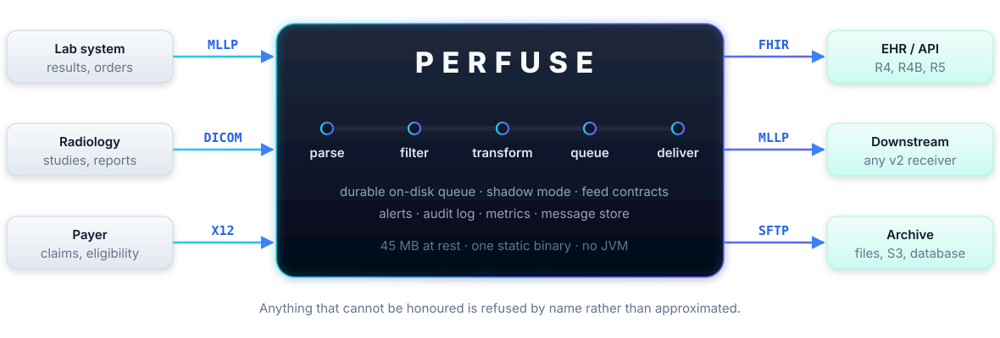
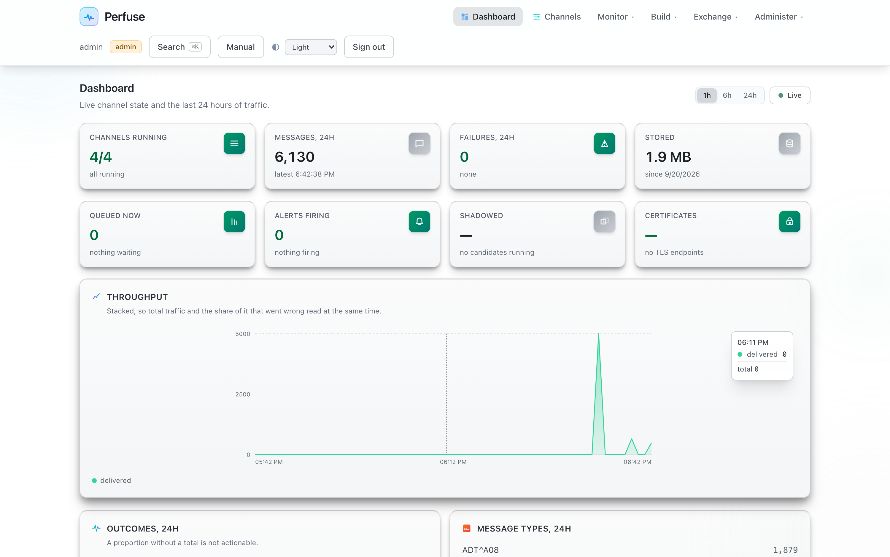
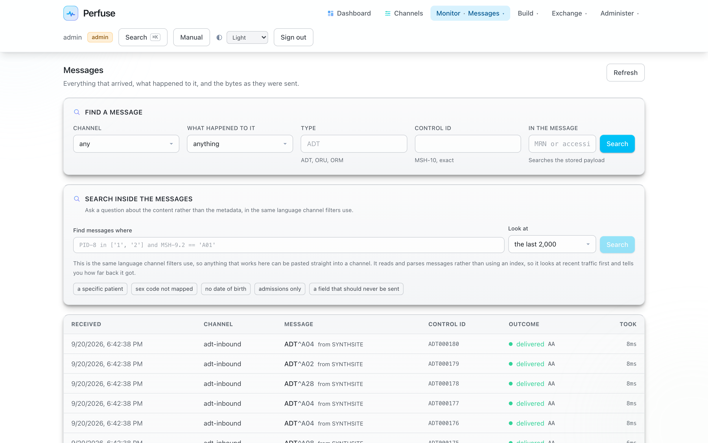
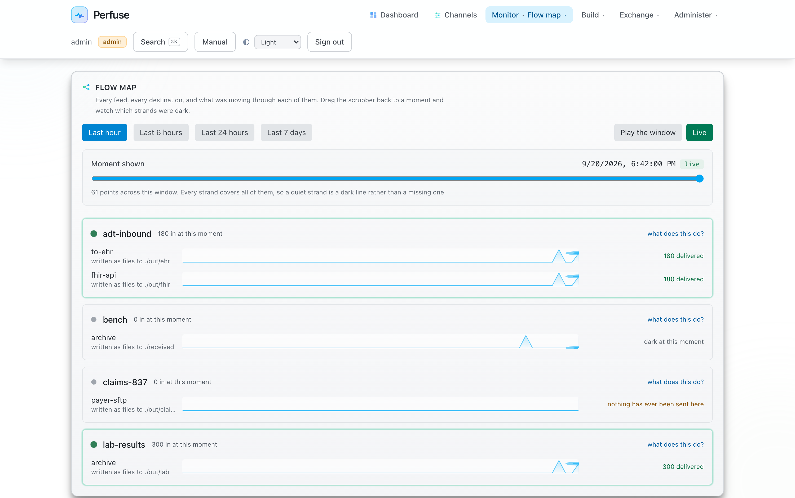
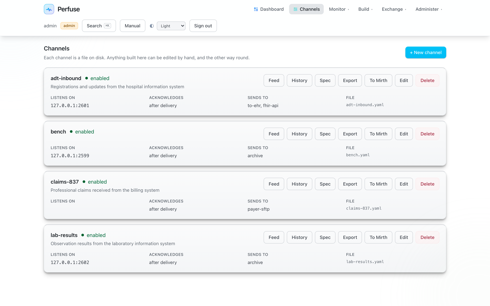
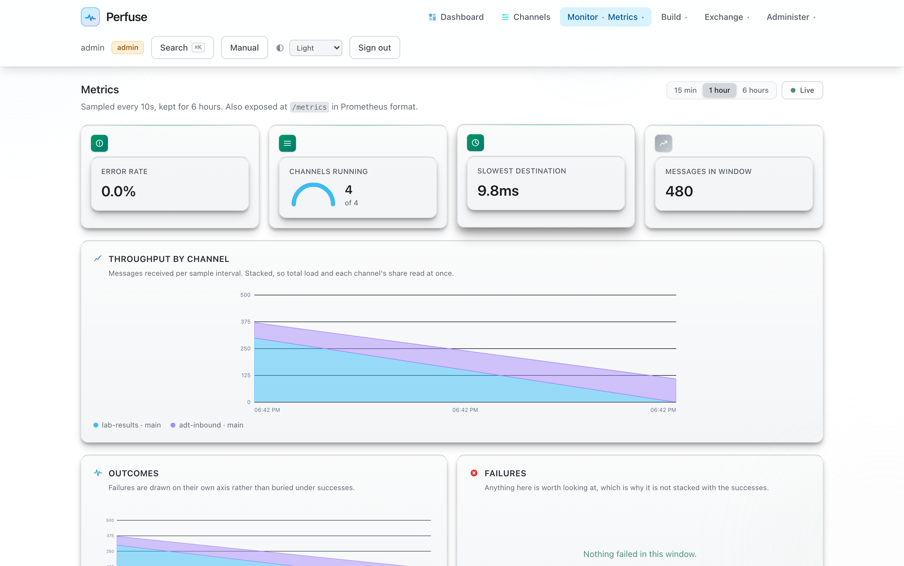
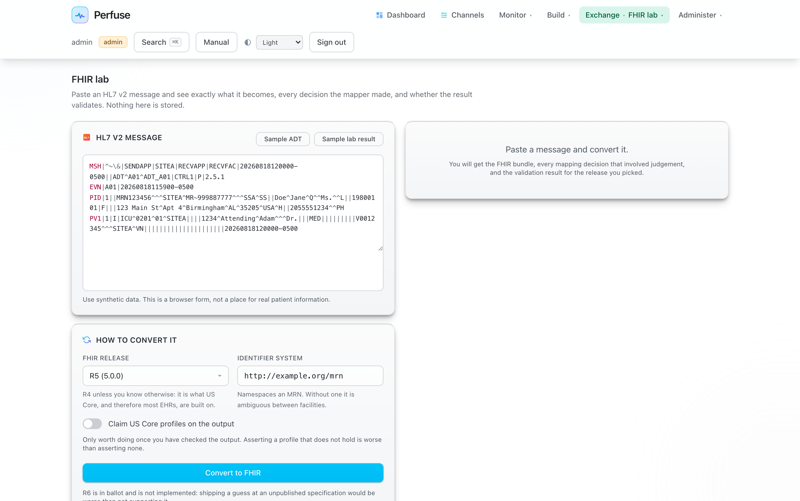

<div align="center">


<h1></h1>

### Open-source healthcare integration engine — HL7 v2, FHIR, DICOM, X12 and CDA in one static binary

**A modern, Apache-2.0 licensed alternative to Mirth Connect.** No JVM. No installer. No paid licence.
Your existing Mirth JavaScript runs unchanged.

**45 MB of memory at rest, against Mirth's 383 MB** — measured on the same machine, both idle. One file to copy
instead of a 254 MB install and a Java runtime, and it starts immediately rather than warming up.

[](LICENSE) [](https://go.dev) [](#download) [](#download) [](#verified-against-real-software-not-mocks)

<a href="https://test.perfuse.health"></a>

<sub><b>Sign in as</b> <code>demo</code> <b>with password</b> <code>try-perfuse-demo</code> · test data only · look at every screen, change nothing</sub>

### Download v0.1.22

<a href="https://github.com/biodream-llc/perfuse/releases/download/v0.1.22/perfuse-v0.1.22-linux-amd64.tar.gz"></a>&nbsp;&nbsp;&nbsp;<a href="https://github.com/biodream-llc/perfuse/releases/download/v0.1.22/perfuse-v0.1.22-darwin-arm64.tar.gz"></a>&nbsp;&nbsp;&nbsp;<a href="https://github.com/biodream-llc/perfuse/releases/download/v0.1.22/perfuse-v0.1.22-windows-amd64.zip"></a>

<sub>One file, nothing to install. [Intel Macs, ARM64 Linux, ARM64 Windows and checksums](#download)</sub>

[**Quick start**](#quick-start) · [**Why Perfuse**](#why-perfuse-exists) ·
[**Mirth migration**](#migrating-from-mirth-connect) · [**Everything it does**](#everything-it-does) ·
[**Standards and versions**](#standards-and-versions-supported) ·
[**Manual**](https://perfuse.health/manual/) · [**Reference**](docs/reference.md) · [**FAQ**](#faq)

[**perfuse.health**](https://perfuse.health) — the manual, the reference and this page, on the web

<a href="https://biodream.io"></a><br>
<sub>A product of <a href="https://biodream.io"><b>BioDream LLC</b></a></sub>

</div>

---

## What is Perfuse?

**Perfuse is an open-source healthcare integration engine** — an interface engine — for moving clinical data
between systems that were never designed to talk to each other. A lab sends results in HL7 v2, an imaging
department speaks DICOM, a payer sends X12, and the receiving system wants FHIR. Perfuse sits in the middle,
parses each of them properly, transforms what needs transforming, and delivers without losing anything.

**What it reads and writes:** HL7 v2 · FHIR R4, R4B and R5 · DICOM and DICOMweb · X12 837, 835, 270/271, 276/277, 834 and 278 ·
SMART Health Links and Cards · International Patient Summary · IHE XDS/XDM documents · S/MIME Direct messages ·
C-CDA and CDA · HL7 v3 · NCPDP Telecommunication, SCRIPT (with ePA) and RTPB · UN/EDIFACT · delimited and raw formats.

**How it connects:** MLLP, TCP, HTTP, SOAP, files, FTP, SFTP, SMB, WebDAV, databases, DICOM, DICOMweb, Kafka, message
brokers, AMQP 1.0 (Azure Service Bus, RabbitMQ 4), MQTT, IBM MQ, Azure Blob Storage, Google Cloud (Pub/Sub and Cloud
Storage), AWS — S3, SQS and SNS — IHE XDS.b and XCA, Direct secure messaging, AS2 trading partners, email mailboxes (IMAP and POP3, with
Microsoft 365 and Gmail OAuth), immunization registries (CDC IIS) and DICOMweb: twenty-eight source types and thirty-one destination types, in both directions.

**What it does beyond moving messages.** A **durable on-disk queue** that keeps ordering and survives a
restart. **Shadow mode**, so a channel can be changed against real traffic while delivering nothing.
**Feed contracts** that tell you when a sender quietly changes something. **TEFCA and UDAP** for exchanging
records with organisations you have no direct connection to. **The four CMS-0057 payer APIs** and a **Plan-Net provider directory**, with claims
as CARIN Blue Button, prior authorisations as Da Vinci PDex and the yearly metrics page. **eCR** public health case reporting.
**SQL on FHIR v2** (FHIR as tables, to Parquet), **digital quality measures** to DEQM MeasureReports, and an **MCP server**
so AI agents can query it under the caller's own role. **SAML, OpenID Connect, LDAP, passkeys, SCIM and mutual
TLS** for sign-on. Metrics, alerting, tracing, an audit log, and a searchable message store.

**And it is one file.** Written in Go, licensed under **Apache 2.0**, running on **Linux, macOS and Windows**
with nothing installed beside it — no Java runtime, no application server, no database to stand up first. The
web console is compiled into the binary, and **everything the configuration files can express can also be done
from the browser,** start-up options included: each `perfuse serve` flag that turns on a feature is also a setting in the
console, applied at the next restart. That is a rule this project holds itself to, not an aspiration: a feature reachable
only from YAML or the command line is treated as a bug.



## Since v0.1.21, on main and not yet released

- **Who ordered a lab result, and who signed it off.** OBR-16, the ordering provider, was written as the report's performer;
  it is now the requester of the order the report is based on (each result's OBR is also a ServiceRequest, as HL7's
  v2-to-FHIR map has it). OBR-32, the principal result interpreter, is now read, and OBR-34 and OBR-35 are performers with
  their function. Against UK Core 185 of 187 resources pass, FR Core 138 of 156, the EU lab report 106 of 426.
- **Order numbers keep who issued them.** A placer or filler order number (OBR-2, OBR-3) now keeps its namespace and
  universal ID as the identifier's system and assigner, so the same number from two organisations stays two identifiers, and
  the order (ServiceRequest) carries the lab's number as well as the requester's.
- **The whole prior authorization round trip with HL7's own provider reference implementation.** Pointed at Perfuse, the Da Vinci
  Burden Reduction provider RI ran CRD, PAS, DTR, CDex attachments and the decision notification end to end, to "Approved". It
  found five faults, all fixed: the `encounter-start` and `encounter-discharge` hooks were missing; a questionnaire was asked for
  in a shape PAS does not describe (now LOINC `102089-0` under the line's trace number, which DTR resolves); a `null` in one
  ClaimResponse; Subscriptions not searchable by `url`; and documents sent under the request's trace number refused.

## New in v0.1.21

- **Da Vinci CRD, DTR and PAS 2.1.0 as well as 2.2.x.** 2.1.0 is the release CMS-0057-F points EHRs at now that 2.0.1's US Core
  3.1.1 base has expired. Perfuse answers a 2.1.0 caller in 2.1.0: it reads the release from the request, the client's
  registration (`davinci_version`) or `-davinci-version`, and rewrites the answer where the releases differ. Every 2.1.0 guide's
  own example requests get answers with no errors from the HL7 validator against 2.1.0; the same calls still pass against
  2.2.x, and Inferno's 2.2.x suites give the same results as before
  ([conformance/davinci21](https://github.com/biodream-llc/perfuse/tree/main/conformance/davinci21)). No Inferno kit tests 2.1.0.
- **`$inquire` finds authorizations asked for any way.** With a UM link that answers in real time, a PAS inquiry is also sent to
  the UM system as an X12 278 inquiry (005010X215), and every authorization it holds that did not come through Perfuse (a fax, the
  payer's portal, a phone call, another submitter's 278) comes back as one more inquiry response, its decision, number and period
  as the UM system gives them; no Claim is made up for it. Checked against a stand-in UM system that judges the inquiry by
  payers' published 278 inquiry companion guides; not yet with a real one.
- **HL7 Europe Laboratory Report 2.1.0, checked:** the lab results among the UK, French and German samples, converted and
  checked against the guide's own profiles: 77 of 391 resources pass, every remaining error with its reason in
  [conformance/national](https://github.com/biodream-llc/perfuse/tree/main/conformance/national). The guide's report is a
  document a sender assembles, and most sample results name no performer or time, which Perfuse does not invent. The run
  fixed three things in the conversion: results now take their report's time when they send none, name the laboratory that
  produced them (OBX-15, OBX-23 to OBX-25), and no longer carry a bare date as a SNOMED CT version.
- **HL7 Europe Hospital Discharge Report 1.0.0, ISiK and Nictiz, checked:** the ADT messages among the samples meet the
  Discharge Report's profiles, 68 of 69. A FHIR destination now takes a `bundle_script`, JavaScript over each converted Bundle,
  for what a hospital's own systems know and an HL7 v2 message does not say; with the example scripts the invented German
  messages go from 18 to 42 of 47 valid against ISiK and the Dutch ones from 12 to 18 of 24 against nl-core (zib 2020), the
  rest listed with its reason in [conformance/national](https://github.com/biodream-llc/perfuse/tree/main/conformance/national).
  The runs fixed: `PR1` procedures (not converted before), diagnoses in `Encounter.diagnosis`, family names sent in parts
  (Dutch `van ...`), OPS categories, and `Procedure.category` written as a list R4 does not allow.
- **Open Integration Engine 4.7.0** (released 21 October) is in the migration test set: it wrote its own channels, library, group and
  backup, which import and run, and it accepts every channel Perfuse exports. Its new HTTP Sender local address is reported when set.

## New in v0.1.20

- **Clean downloads.** The same code as v0.1.19. Every Linux and macOS archive before this one recorded the account that built
  it as the owner of its files; these are root's, and the older archives have been removed from their releases.

## New in v0.1.19

- **National FHIR profiles, checked:** HL7 v2 converted to FHIR and checked by the HL7 validator against UK Core (NHS Wales'
  published samples: 177 of 179 resources pass), FR Core (the French agency's samples: 124 of 142) and ISiK (invented German
  messages: 12 of 37), every remaining error listed with its reason in [conformance/national](https://github.com/biodream-llc/perfuse/tree/main/conformance/national).
  The runs fixed German year-stamped code systems (`I10G2026`, `OPS2016`: now ICD-10-GM and OPS with their version), national
  numbers left under their OIDs (KVNR, NHS number: now under their national systems, the KVNR typed KVZ10), `PI` patient numbers
  without `use: usual`, and practitioners' name and identifier types (France's IDNPS) being dropped.
- **A free public payer sandbox** for EHR developers, [perfuse.health/sandbox](https://perfuse.health/sandbox/): Da Vinci CRD, DTR
  and PAS on test.perfuse.health with published test keys, and a script that runs the whole round.
- **Go 1.27.3** (GO-2026-6809: crypto/x509 now distrusts compromised intermediates).

- **PIX and PDQ in HL7 version 3:** with the patient index on, `/pixv3` is an IHE PIX Manager (ITI-44 identity feed, with
  merges; ITI-45 query) and `/pdqv3` a PDQ Supplier (ITI-47, with continuation and cancel), over SOAP, from the same index as
  PIXm and `$match`. The answers validate against IHE's HL7 V3 schemas and answer IHE's own sample messages.
- **Direct, three more ways:** a Direct source reads the address's **IMAP mailbox** at the HISP and takes **XDR** (ITI-41 over
  SOAP with a Direct addressing block); an `xds` destination sends XDR with `direct_from` and `direct_to`; and recipient
  certificates are looked up in the domain's **LDAP** directory when DNS has none. Checked against OpenLDAP, GreenMail, the
  NIST XDS Toolkit's Document Recipient and ONC SITE's Direct XDR Edge Test Tool (both ways).
- **Fixed:** ONC SITE's XDR validator, the (h)(2) certification reference, faulted on every XDR message Perfuse sent
  (its parser cannot read XML that redeclares the default namespace on each element, as Go writes it). Metadata now goes out
  prefixed, as in IHE's samples, with `mustUnderstand` on `wsa:MessageID`; SITE answers Success both ways, sending and receiving.
- **Direct certificate checks, against ONC's Certificate Discovery Tool:** a Direct destination now refuses a recipient
  certificate revoked on its issuer's CRL and fetches missing intermediates from AIA; the LDAP lookup asks the configured DNS
  server and works with ApacheDS; a failed address-bound DNS answer falls back to the domain. All 18 DCDT discovery cases pass
  (9 did before). A Direct source also reads SITE's own HISP over IMAP (`imap.tls` trusts a HISP's private certificate).
- **PAS to X12 278, checked against published 278s:** the 278s sent to a payer's UM system now carry the review type, level of
  service, place of service, admission dates, service provider and hospital service lines that PAS names; urgent is no longer
  sent as emergency, cancellations are understood, and admission reviews read correctly. Checked with PAS's own examples and
  CMS's esMD samples; not yet with a real UM system.
- **The UM link reaches payers the ways they take 278s:** CAQH CORE SOAP (vC2.2.0, and vC4.0.0 with MTOM), CORE HTTP MIME, and
  batch files over SFTP, beside X12 over HTTPS; client certificates, OAuth, passwords. A TA1 or 999 instead of an answer is read
  and shown. Configured and watched from the console. Tested end to end against a stand-in UM system written from CAQH's rules.
- **Fixed:** an HTTP source cut the last byte off any body ending in 0x1C (taking it for MLLP framing), which broke one
  OpenPGP message in 256 and any other binary body ending that way. An `xds` destination sent a CDA document's confidentiality as its meaning (`normal`) instead of its code (`N`), and
  codes without a display had no name, which a strict registry refuses. The shared demo account may press the checks that change
  nothing (a script's Check, the channel editor's validate and parse). The v0.1.17 notes below were relabelled v0.1.18 by the
  release script, which now leaves "New in" headings alone.

## New in v0.1.18

For the UK and Europe, and every screen of the public test server at work.

- **The console in twelve languages:** English, German, French, Dutch, Spanish, Italian, Portuguese, Polish, Swedish, Danish,
  Norwegian and Finnish, chosen in the header, with dates and numbers written the locale's way. Every screen in every language
  is checked by a test that fails on any text left in English; code, messages and anything typed are never translated. The
  manual is published in the same languages. The translations were made by machine (Llama 3.3 70B) and have not yet been
  reviewed by native speakers, and each says so.
- **National patient numbers:** the NHS number (and Scotland's CHI and Northern Ireland's H&C number), PPSN, KVNR, SVNR, AHV,
  BSN, the Belgian national register number, the French INS, codice fiscale, DNI/NIE, the Nordic, Baltic and central European
  numbers: 37 schemes, each checked by its check digit and stored one way, so an NHS number sent under its OID and under its
  FHIR URL is one identifier. A mistyped number is kept but never links two records. HL7 v2 `NN<country>` and `NH` types are
  read; numbers are masked below a role an administrator sets.
- **National code systems:** SNOMED CT national editions from their whole RF2 package (the display in the country's language,
  every language's terms as designations, `$lookup` with `displayLanguage`); ClaML for WHO ICD-10, ICD-10-GM, OPS and CIM-10 FR;
  the ICD-11 tabulation and the WHO ICD API; delimited national tables in any encoding; versions in force from an effective date.
- **GDPR and UK GDPR:** a Data protection screen that finds everything held about a person in every store, gives them a copy,
  erases it with a second administrator's approval, keeps it under a legal hold (which the retention window respects), and
  re-applies erasures to a restored backup from a ledger of salted hashes. The record of processing (Article 30) from the
  channels; retention per kind of record; a draft data processing agreement for hosting.
- **Data residency:** `-residency eea` (or `uk`, `ch`, region codes) refuses channels whose cloud connectors are elsewhere.
  OpenTofu for hosting one organisation in Frankfurt, Ireland or London with everything in the Region, with list-price costs.
- **Fixed on the way:** a feed contract beside its channel was listed as a broken channel; a shadow comparison started from
  the console never started on a server run as a service; the XDS and DICOMweb connectors sent `${ENV}` credentials
  literally (a DICOMweb source accepted the text `${STOW_TOKEN}` as its token); a data protection erasure by a bare record
  number left the patient index record behind. See [verification](docs/verification.md).
- **The public test server shows every screen at work**, with invented data (patients, results, the patient index, imaging,
  documents, a queue that fills while a receiver is away and drains when it is back, a shadow comparison, data protection requests), and its
  shared demo account may read the administrators' screens too. [Try it](https://test.perfuse.health).
- **`perfuse generate`** gives small mixed batches every kind of message, and no longer repeats its identifiers between runs.

## New in v0.1.17

<details><summary>Clusters, PostgreSQL, the patient index, AS2, OpenPGP, EDIFACT, mailboxes, terminology, SNMP</summary>


- **Clusters:** two or more servers on one PostgreSQL store take over from each other: active-passive (the leader runs
  everything) or active-active (channels spread over the servers, moved by hand from the console). Leases measured on
  each server's own clock, so no two servers ever run one feed; configuration kept the same on every server through the
  store; `/readyz?channel=` for the load balancer. Killed with SIGKILL mid-stream in the tests: nothing acknowledged lost.
  Tested on AWS too: Linux and Windows servers in three zones, Amazon RDS over checked TLS, a Network Load Balancer, a
  leader cut off from the database and clocks two minutes apart; 16,000 acknowledged messages, none lost.
- **PostgreSQL for everything:** messages, queues, accounts, the audit log, the FHIR store, terminology and the patient
  index, with `-db postgres://...`; SQLite stays the default for one server.
- **Master patient index:** records from every system linked into one enterprise identifier per person, deterministic
  (trusted identifiers) and probabilistic (Fellegi-Sunter, Jaro-Winkler) matching, a review queue, links, unlinks and A40
  merges with their history, FHIR `Patient/$match` and PIXm; off until a site turns it on, and automatic linking off
  until an administrator trusts it (measured on FEBRL: no wrong links), with weights it can estimate from the site's records.
- **AS2 (RFC 4130):** EDI with trading partners over HTTP, signed and encrypted with S/MIME, delivered only when the partner's
  signed receipt names the digest of what was sent; synchronous and asynchronous receipts; tested against pyas2lib both ways.
  Compressed messages (RFC 5402) both ways, and a resend of a message already passed on is answered with a receipt and
  not delivered twice.
- **OpenPGP:** decrypt and verify what a source receives, encrypt and sign what a destination sends (files, SFTP, S3, email,
  HTTP), with keys checked when the channel loads; tested against GnuPG in both directions.
- **UN/EDIFACT:** a data type with envelope checks (UNB/UNZ, UNH/UNT counts), element filters and paths, one message per
  UNH, and CONTRL acknowledgements; tested against pydifact.
- **Mailbox source:** IMAP and POP3, with Microsoft 365 and Gmail sign-in by OAuth 2.0; the body or attachments become the
  messages, then the mail is moved, flagged or deleted; tested against GreenMail.
- **Terminology:** mapping tables with editions and effective dates (each message uses the edition in force that day),
  and an optional second person's approval; values no table maps, counted and listed; LOINC, SNOMED CT, RxNorm,
  ICD-10-CM and local code systems imported for search, `CodeSystem/$lookup` and `$validate-code`.
- **SNMP:** a read-only SNMPv2c agent (channel states, message counts, queue depths) and alert traps, with a MIB to
  download from the console.
- **Mirth scripts:** JavaScript equivalents of the Java classes Mirth scripts use most, so more of them run unchanged.
- **Supply chain:** `govulncheck` runs in CI and gates every release; Go 1.27.2 and current x/crypto, x/net and x/text.

</details>

## Everything it does

Eighteen areas. Nothing here is aspirational: where something is partial it says so, and the [verification record](docs/verification.md)
says what each claim was checked against. The [manual](https://perfuse.health/manual/) covers every one in full.

<table width="100%">
<tr>
<td width="50%" valign="top">
<br>
<b>Parse, route, transform, generate, acknowledge</b>
<ul>
<li>A parser that <b>indexes rather than decodes</b>: reading one field does not rebuild the message</li>
<li>Segments, fields, repetitions, components, subcomponents, <b>Z-segments</b>, non-standard separators and every escape sequence</li>
<li><b>MLLP</b> both ways with TLS, plus TCP, HTTP and files</li>
<li>A <b>field dictionary</b>: "the patient's family name", not <code>PID-5.1</code></li>
<li><code>AA</code> / <code>AE</code> / <code>AR</code> and <b>enhanced-mode</b> acknowledgements, sent <b>after delivery</b> by default</li>
<li><code>perfuse generate</code> for synthetic traffic, <code>perfuse deident</code> for a shareable corpus, <code>send</code> and <code>listen</code> for testing</li>
</ul>
</td>
<td width="50%" valign="top">
<br>
<b>R4, R4B and R5: mapper, server, validator</b>
<ul>
<li><b>HL7 v2 to FHIR</b>: ADT, ORU, SIU, MDM and VXU to Patient, Encounter, Observation, DiagnosticReport, Appointment, DocumentReference and Immunization</li>
<li><b>US Core 9.0.0 (USCDI v6)</b> claimed only after the resource is checked against the profile; no errors from the HL7 validator</li>
<li><b>A FHIR REST server</b>: search, chains, <code>_include</code>, <code>_has</code>, transactions, history, <b>Bulk Data <code>$export</code></b></li>
<li><b>Subscriptions</b> (R5 Backport for R4), recorded in the same transaction as the change</li>
<li><b>A site's own facts added</b> with a FHIR destination's <code>bundle_script</code>: JavaScript over each converted Bundle, for what the hospital's systems know and a v2 message does not say (an IK number, a contact level)</li>
<li>Write limits for a public server: writes a minute per client, and a resource cap</li>
<li><code>fhir</code> as a destination; a <b>browser FHIR lab</b>; <code>perfuse fhir</code> to convert, validate and serve</li>
<li><b>SMART Health Links and Cards</b> (<i>Kill the Clipboard</i>): read a patient's QR code, verify the cards, share the visit back</li>
<li><b>International Patient Summary</b>: <code>Patient/$summary</code> builds an IPS 2.0.0 document from the store; empty sections say so rather than reading as none</li>
<li><b>SQL on FHIR v2</b>: ViewDefinitions on its own FHIRPath engine, <code>$sql-run</code> and <code>perfuse sof</code>, to CSV, NDJSON or <b>Parquet</b>; passes all 144 official tests</li>
<li><b>Digital quality measures</b>: FHIRPath Measures, <code>Measure/$evaluate-measure</code> and <code>perfuse measure</code>, to DEQM MeasureReports (summary, individual, subject-list; strata); no CQL engine</li>
</ul>
</td>
</tr>
<tr>
<td width="50%" valign="top">
<br>
<b>The DIMSE services and DICOMweb, both directions</b>
<ul>
<li><b>C-STORE, C-FIND, C-ECHO, C-MOVE and C-GET</b>, sending and receiving</li>
<li>A <b>DICOM query source</b>: a scheduled C-FIND whose results become messages</li>
<li><b>DICOMweb</b>: an archive served over QIDO-RS, WADO-RS, WADO-URI and STOW-RS for viewers such as OHIF; STOW-RS in and out of channels</li>
<li><b>De-identification</b> as a pipeline step: patient removed, private tags stripped, AE title set</li>
<li>Metadata into tags a filter can read; studies onward as <b>HL7 v2 or FHIR</b></li>
<li>Checked against <b>Orthanc</b>, by Orthanc's own catalogue</li>
</ul>
</td>
<td width="50%" valign="top">
<br>
<b>Claims, payers and pharmacy, parsed as structures</b>
<ul>
<li><b>837</b> claims, <b>835</b> remittance, <b>270/271</b> eligibility, <b>276/277</b> claim status, <b>834</b> enrolment, <b>278</b> prior authorization</li>
<li>Interchange, group, transaction, loops and qualifiers understood; X12 to XML and back</li>
<li><b>275 claims attachments</b> in the 006020 form CMS-0053-F adopts, built and read</li>
<li><b>Da Vinci PAS to and from the X12 278</b>, and 278 decisions to PAS ClaimResponses that pass the HL7 validator</li>
<li>997 and 999 are separate, and Perfuse says so rather than pretending acknowledgement is synchronous</li>
<li>Pharmacy too: <b>NCPDP Telecommunication</b> claims and <b>NCPDP SCRIPT</b> prescriptions, with a missing substitution flag refused</li>
<li><b>UN/EDIFACT</b> interchanges: envelope counts checked, filtered by element, split per message, <b>CONTRL</b> acknowledgements; checked with pydifact</li>
</ul>
</td>
</tr>
<tr>
<td width="50%" valign="top">
<br>
<b>C-CDA and CDA, including the ones inside v2</b>
<ul>
<li>Read, validate and convert <b>C-CDA and CDA</b>, including documents <b>base64-encoded inside an MDM^T02</b></li>
<li><b>The narrative is compared with the coded entries</b>, and a document whose two halves disagree is flagged</li>
<li><b>Transfer summaries for post-acute care:</b> a hospital's C-CDA becomes a <b>PACIO Transitions of Care</b> document (FHIR R4, US Core 8.0.1) for the nursing home, rehabilitation unit or home health agency the patient goes to next</li>
<li>Templates reported by name; repair of malformed documents; <b>PDF rendering</b>; merging several into one</li>
<li><b>HL7 v3</b>, delimited and raw formats, read by element and attribute</li>
<li><b>Signed claims attachments</b> (HL7 DSDR): XAdES-X-L with OCSP and RFC 3161 time-stamps, signed and verified; checked with xmlsec1 and OpenSSL</li>
<li>CDA and document destinations, and a browser lab</li>
<li><b>IHE XDS.b</b> registry and repository, <b>XCA</b> gateway and <b>MHD</b>, <b>PIXm</b>, <b>PDQm</b>; an xds destination publishing CDA; checked with the <b>NIST XDS Toolkit</b></li>
<li><b>Direct secure messaging</b> through your HISP: S/MIME signed and encrypted, <b>IHE XDM</b> packages, MDNs, certificates from an address book or <b>DNS CERT</b>; checked with OpenSSL</li>
<li><b>OpenPGP</b> on any source or destination: decrypt, verify, encrypt, sign; checked with GnuPG</li>
</ul>
</td>
<td width="50%" valign="top">
<br>
<b>28 source types, 31 destination types</b>
<ul>
<li><b>Sources:</b> MLLP · TCP · HTTP · SOAP · file · FTP · SFTP · SMB · WebDAV · database · DICOM · DICOM query (C-FIND) · DICOMweb (STOW-RS) · <b>Kafka</b> · message broker (STOMP) · <b>Amazon SQS</b> · <b>Amazon S3</b> · <b>AMQP 1.0</b> (Azure Service Bus, RabbitMQ 4, ActiveMQ) · <b>Azure Blob</b> · <b>MQTT</b> · <b>IBM MQ</b> · <b>Google Cloud Pub/Sub</b> · <b>Google Cloud Storage</b> · <b>Direct</b> (from a HISP) · <b>AS2</b> (trading partners, signed receipts) · <b>email</b> (IMAP, POP3; Microsoft 365 and Gmail OAuth) · JavaScript Reader · serial</li>
<li><b>Destinations:</b> MLLP · TCP · HTTP · SOAP · SMTP · file · FTP · SFTP · S3 (any storage class, Glacier included) · <b>Amazon SQS</b> · <b>Amazon SNS</b> · <b>AMQP 1.0</b> · <b>Azure Blob</b> (Hot, Cool, Cold, Archive) · <b>MQTT</b> · <b>IBM MQ</b> · <b>Google Cloud Pub/Sub</b> · <b>Google Cloud Storage</b> · database · DICOM · DICOMweb · FHIR · CDA · <b>IHE XDS.b</b> · <b>Direct</b> secure messaging · <b>AS2</b> · the <b>patient index</b> (mpi) · document · JavaScript · <b>Kafka</b> · message broker (STOMP) · another channel</li>
<li>Databases: <b>PostgreSQL, MySQL, SQL Server, Oracle, SQLite</b>, the dialect checked when the channel is saved</li>
<li><b>Kafka keyed per patient</b>, offsets committed after the batch; an SQS message deleted only once handled</li>
<li>AWS, Azure and Google Cloud <b>without their SDKs</b>; S3 archives as <b>date-partitioned JSON for Athena</b></li>
<li>Files named from the message, written under a temporary name, appended or pruned after a set time</li>
</ul>
</td>
</tr>
<tr>
<td width="50%" valign="top">
<br>
<b>Declarative steps, or JavaScript or Lua</b>
<ul>
<li>Eleven steps with no code: <b>set, copy, remove, clear, default, case, date, pad, trim, replace, map</b>, each with an optional <code>when</code></li>
<li>Filters with <code>&amp;&amp;</code>, <code>||</code> and <code>!</code>, in the same language the message search uses</li>
<li><b>JavaScript</b>, including <b>the Mirth dialect</b> with E4X, or sandboxed <b>Lua</b>; shared script libraries</li>
<li><b>Shared mapping tables</b> with who decided each mapping and why; code sets and value-set lookups</li>
<li><b>AI Mapper</b>: mapping suggestions with a confidence each, from rules on this server, with no model and no network call</li>
<li>Attachments moved out of a message and put back; an unmapped code is <b>kept</b>, a malformed date <b>stops the message</b></li>
</ul>
</td>
<td width="50%" valign="top">
<br>
<b>A durable queue that does not lose messages</b>
<ul>
<li><b>An on-disk queue per destination</b>: one slow receiver holds up nobody else, and a restart loses nothing</li>
<li><b>Order kept</b>: message 2 waits until message 1 succeeds or is given up on</li>
<li>Exponential backoff, and <b>dead letters that keep the message</b></li>
<li>Inspect, retry, skip and drain from the console; replay and reprocess from the stored original</li>
<li>Killed mid-batch five times: <b>255 acknowledged, 255 delivered</b>, none lost, none duplicated</li>
</ul>
</td>
</tr>
<tr>
<td width="50%" valign="top">
<br>
<b>Sign-on, roles and channel groups</b>
<ul>
<li><b>SAML 2.0</b> (checked with Keycloak and Microsoft Entra), <b>OpenID Connect</b>, <b>LDAP / Active Directory</b>, <b>passkeys</b>, <b>SCIM 2.0</b>, <b>mutual TLS</b></li>
<li>Six roles: <b>monitor</b>, viewer, <b>operator</b>, editor, admin, platform; API tokens for machines; an <b>audit log</b></li>
<li><b>Channel groups</b> for a hospital group on one server, with a <b>different role in each group</b> if needed</li>
<li>Directory groups map to <b>any of the six roles and to channel groups</b> at every sign-in</li>
<li><b>A SMART on FHIR authorization server</b>: Inferno's SMART App Launch STU2.2 suite <b>80 of 80</b></li>
<li>An <b>MCP server</b> for AI agents: status, messages, queue, alerts and FHIR under a token's own role and groups, read-only unless granted, every call audited</li>
<li>No patient data over plain HTTP off loopback; cloud metadata addresses refused at connect time; PHI access watched for volume, after-hours and bulk reads</li>
</ul>
</td>
<td width="50%" valign="top">
<br>
<b>UDAP, Facilitated FHIR and its auditing</b>
<ul>
<li><b>UDAP</b>: discovery, dynamic client registration and <b>signed metadata verification</b></li>
<li><b>Facilitated FHIR</b> exchange between TEFCA participants, following the SOP</li>
<li><b>Every exchange audited</b> and written to disk, with purpose-of-use rules</li>
<li>Partner discovery with certificate chain verification, checked against a real trust community</li>
</ul>
</td>
</tr>
<tr>
<td width="50%" valign="top">
<br>
<b>CMS-0057, and drugs for CMS-0062-P</b>
<ul>
<li><b>Patient Access, Provider Access, Payer-to-Payer and Prior Authorization</b>, with a screen saying which are ready</li>
<li><b>Da Vinci CRD 2.2.1</b> over CDS Hooks, <b>DTR 2.2.0</b> questionnaire packages, and a <b>PAS 2.2.1 server</b> (each also answering <b>2.1.0</b> clients): <code>$submit</code>, <code>$inquire</code>, <code>$decide</code></li>
<li>A <b>reviewer queue</b> for pended requests, with the documents sent for each</li>
<li>A <b>UM link</b>: PAS requests to the payer's utilization management system as <b>X12 278</b> (HTTPS, CAQH CORE SOAP and MIME, SFTP batch), and <code>$inquire</code> also finds authorizations requested by fax, portal or phone</li>
<li>An optional <b>decision service</b> asked about what the rules leave to a reviewer (we recommend <b>Vaglio</b>, source-available; any engine plugs in); any failure pends, never approves</li>
<li>Claims to <b>CARIN Blue Button 2.2.0</b>, decisions to <b>PDex 2.2.0</b>, <code>$member-match</code>, <code>$davinci-data-export</code>, a <b>Plan-Net</b> directory</li>
<li>The yearly <b>prior authorization metrics page</b> in CMS's layout</li>
<li>Drugs: <b>NCPDP SCRIPT ePA</b> and <b>Real-Time Prescription Benefit</b> from one formulary, published over the <b>Da Vinci US Drug Formulary 2.1.0</b> API; decided through PAS</li>
<li>Inferno: CRD <b>passes</b>, DTR <b>43/45</b>, PAS <b>82/84</b>, PDex payer-to-payer <b>19/19</b>, Bulk Data <b>48/48</b></li>
<li><b>CMS Aligned Network readiness</b>: all 26 Interoperability Framework criteria, each read from what is switched on, with what is yours to do</li>
</ul>
</td>
<td width="50%" valign="top">
<br>
<b>eCR, ELR and immunization registries</b>
<ul>
<li><b>eCR 2.1.2</b>: an eICR for each message with a reportable-condition trigger code, from the RCTC you load</li>
<li><b>Reportability Responses</b> received at <code>$process-message</code>, and a test agency to try the round trip</li>
<li><b>ELR</b>: a lab's ORU^R01 reshaped into HL7 2.5.1 ELR with only the reportable orders; ONC's tool reports all 28 of its examples valid</li>
<li><b>Immunization registries</b> on the CDC IIS web service: VXU and QBP submitted, the registry's ACK judged, and a registry endpoint to test against</li>
</ul>
</td>
</tr>
<tr>
<td width="50%" valign="top">
<br>
<b>Shadow mode, feed contracts, drift</b>
<ul>
<li><b>Shadow mode</b>: a candidate channel runs beside the live one <b>on real traffic</b>, delivering nothing, and every difference is shown field by field</li>
<li><b>Feed contracts</b>: what a feed should contain, and an alert when the sender drifts</li>
<li><code>perfuse profile</code> says what is actually in a feed; <code>perfuse compare</code> proves two engines agree</li>
<li><code>perfuse test</code> runs a channel's tests in CI; channel history read from git</li>
</ul>
</td>
<td width="50%" valign="top">
<br>
<b>Dashboards, alerts, search, fleet, tenants</b>
<ul>
<li>A <b>live dashboard</b>, a <b>flow map</b> with a time scrubber, and <b>team dashboards</b> (operations, connections, prior auth, imaging, revenue cycle, lab, privacy), exportable to <b>Grafana</b></li>
<li><b>Eleven alert kinds</b>, including <b>below rhythm</b>: a feed quieter than its own history</li>
<li><b>Prometheus</b> metrics, <b>OTLP</b> tracing, and VPN tunnel state from AWS, Azure or strongSwan</li>
<li><b>Find a patient's messages</b> by MRN, name, birth date, accession or claim number across HL7 v2, FHIR, DICOM and X12, every search audited</li>
<li>A <b>fleet view</b> of several servers, and <b>multi-tenancy</b> with limits per tenant</li>
<li>Everything in the browser: <b>over 35 screens</b>, three themes, a <b>⌘K</b> palette, settings applied with a restart button</li>
<li>One static binary as a <b>systemd</b>, <b>launchd</b> or <b>Windows</b> service; <code>perfuse init</code> writes it</li>
</ul>
</td>
</tr>
<tr>
<td width="50%" valign="top">
<br>
<b>Both directions: Mirth 4.5.2, OIE, BridgeLink</b>
<ul>
<li><b>Existing Mirth JavaScript runs unchanged</b>: E4X, <code>channelMap</code>, <code>$()</code>, <code>DateUtil</code>, <code>SerializerFactory</code>, and the Java scripts reach for most (<code>HashMap</code>, <code>ArrayList</code>, <code>StringBuilder</code>, <code>SimpleDateFormat</code>, <code>Pattern</code>, Commons <code>StringUtils</code> and <code>Base64</code>: 50 classes) as JavaScript equivalents</li>
<li><code>perfuse explain</code> says <b>by name</b> what converts, what converts with caveats and what does not</li>
<li><code>perfuse translate</code> converts channels, groups, code template libraries or a <b>whole server backup</b></li>
<li><b>Export back</b>: Mirth, OIE 4.5.2, 4.6.0 and 4.7.0, and BridgeLink 26.9.0 all accept the channel files Perfuse writes</li>
<li>A <b>lock-in audit</b> of the Java your channels depend on</li>
</ul>
</td>
<td width="50%" valign="top">
<br>
<b>An API for everything, and Go libraries</b>
<ul>
<li>Every screen is the <b>REST API</b> underneath, with API tokens for machines</li>
<li><code>github.com/biodream-llc/perfuse/hl7</code>: the HL7 v2 parser as a standalone library</li>
<li><code>…/perfuse/fhir</code> (the FHIR model) and <code>…/perfuse/pas</code> (the PAS request reader), standard library only</li>
<li><code>perfuse sbom</code> lists everything linked in; every release ships an SBOM and checksums</li>
</ul>
</td>
</tr>
<tr>
<td width="50%" valign="top">
<br>
<b>Clusters, PostgreSQL, the patient index</b>
<ul>
<li><b>Clusters</b>, active-passive or active-active, on one PostgreSQL store: no two servers ever run one feed, and nothing acknowledged is lost when one is killed</li>
<li><b>PostgreSQL for everything</b> (messages, queues, FHIR, terminology, audit), SQLite for one server</li>
<li>A <b>master patient index</b>: deterministic and probabilistic matching, a review queue, merges with their history, <code>Patient/$match</code> and PIXm</li>
<li><b>AS2</b>, <b>OpenPGP</b>, <b>UN/EDIFACT</b> and <b>mailboxes</b> for trading partners; <b>SNMP</b> for the network team</li>
</ul>
</td>
<td width="50%" valign="top">
<br>
<b>The UK and Europe</b>
<ul>
<li>The console and the manual in <b>twelve languages</b> (machine translated, marked as such)</li>
<li><b>37 national patient numbers</b> checked by their check digits: NHS, CHI, PPSN, KVNR, BSN, INS, codice fiscale, the Nordic numbers…</li>
<li><b>SNOMED CT national editions</b>, ClaML (ICD-10-GM, OPS, CIM-10), <b>ICD-11</b></li>
<li><b>GDPR and UK GDPR</b>: find, export, erase with a second approval, legal holds, an erasure ledger that survives a restore</li>
<li><b>Data residency</b> checks, and OpenTofu for hosting in Frankfurt, Ireland or London</li>
<li>Checked against <b>UK Core, FR Core, ISiK, Nictiz nl-core</b> and HL7 Europe's <b>Laboratory</b> and <b>Hospital Discharge</b> reports, every failure explained (<a href="#national-and-european-profiles">results</a>)</li>
</ul>
</td>
</tr>
</table>

## Standards and versions supported

Which release of each standard Perfuse implements, and how that was checked. "Checked" names the outside tool or
reference that judged the result; where nothing outside has judged it, it says so. Results are from test data, not from a
production site.

#### Messaging and documents

| Standard | Release | Checked |
|---|---|---|
| HL7 v2 | any version: messages are read by their own separators, not a version's schema; acknowledgements default to 2.5.1 | NIST HL7 v2 validator; real Mirth and OIE traffic |
| HL7 v2 to FHIR | HL7's V2-to-FHIR mapping (ADT, ORU, SIU, MDM, VXU and the segments in them) | the HL7 FHIR validator against US Core, UK Core, FR Core, ISiK, nl-core and HL7 Europe |
| FHIR | R4 (4.0.1), with R4B and R5 read and written | the HL7 FHIR validator; Inferno |
| C-CDA and CDA | C-CDA 2.1 | ONC SITE (C-CDA samples sent and received over XDR); not by a CDA schematron |
| HL7 v3 | PIX and PDQ (IHE ITI-44, 45, 47) | IHE's NE2008 schemas and sample messages |
| DICOM and DICOMweb | DIMSE C-STORE, C-FIND, C-MOVE, C-GET, C-ECHO; QIDO-RS, WADO-RS, WADO-URI, STOW-RS | Orthanc |
| X12 (HIPAA) | 005010: 837, 835, 270/271 (X279A1), 276/277 (X212), 834, 278 request (X217) and inquiry (X215); 275 in 006020 (X314) | payers' published companion guides; CMS esMD samples |
| CAQH CORE connectivity | vC2.2.0 SOAP and MIME, vC4.0.0 with MTOM | a stand-in UM system written from CAQH's rules |
| NCPDP | Telecommunication D.0; SCRIPT 2023011 (and 2017071) with ePA; Real-Time Prescription Benefit v13 | written from the public Surescripts companion guides and their examples; not against NCPDP's licensed schemas |
| UN/EDIFACT | syntax 3 and 4, CONTRL | pydifact 0.1.8 |
| IHE document sharing | XDS.b, XCA, XDR, MHD 4.2.2, PIXm, PDQm, XDM | the NIST XDS Toolkit; ONC SITE |
| Direct secure messaging | Applicability Statement 1.2, XDR and XDM for Direct, DNS and LDAP certificate discovery | ONC SITE; ONC's Certificate Discovery Tool (18 of 18) |
| AS2 | RFC 4130, compression RFC 5402 | pyas2lib |
| Signed attachments | HL7 DSDR, XAdES-X-L | xmlsec1, OpenSSL |

#### FHIR implementation guides

| Guide | Release | Checked |
|---|---|---|
| US Core | conversions to 9.0.0 (USCDI v6); FHIR server against 6.1.0 and 7.0.0 | the HL7 validator; Inferno US Core |
| SMART App Launch | 2.2 | Inferno: 80 of 80 (public app) |
| Bulk Data Access | 2.0.0 | Inferno: 48 of 48 |
| Subscriptions R5 Backport | for R4 | a real HTTP receiver; the PAS kit's notification tests |
| Da Vinci CRD | 2.2.1, and 2.1.0 | Inferno 2.2.1: 92 pass, none fail; 2.1.0 by the guide's own examples |
| Da Vinci DTR | 2.2.0, and 2.1.0 | Inferno 2.2.0: 43 pass, 2 fail (a kit defect); 2.1.0 by the guide's own examples |
| Da Vinci PAS | 2.2.1, and 2.1.0 | Inferno 2.2.1: 82 of 84; 2.1.0 by the guide's own examples |
| Da Vinci PDex | 2.2.0 | Inferno PDex 2.0: payer-to-payer 19 of 19 |
| Da Vinci HRex `$member-match` | 1.2.0 | Inferno PDex payer-to-payer |
| Da Vinci ATR | 2.1.0 | not checked by an outside tool |
| Da Vinci CDex `$submit-attachment` | 2.1 | not checked by an outside tool |
| Da Vinci Plan-Net | 1.1.0 | Inferno: 199 pass, 10 fail (a kit defect) |
| Da Vinci US Drug Formulary | 2.1.0 | the HL7 validator |
| PACIO Transitions of Care, Medication Profile, Advance Directives, Functioning | 1.0.0, 1.0.0, 2.0.0-ballot, 2.0.0 | PACIO's Inferno kits with PACIO's own data: every failure in its data or the kit. C-CDA to TOC document: the HL7 validator on HL7's examples, one error left, the guide's own |
| CARIN Blue Button | 2.2.0 | the HL7 validator |
| eCR | 2.1.2 | the HL7 validator |
| ELR | HL7 2.5.1 ELR Release 1 with its errata | ONC's ELR tool: 28 of 28 |
| International Patient Summary | 2.0.0 | the HL7 validator |
| DEQM | 5.0.0 | the HL7 validator |
| SQL on FHIR | v2 | the official test suite: 144 of 144 |
| SMART Health Cards and Links | Cards 1.4, Links STU 1 | the specifications' own example card; a published SMART Health Links viewer library |
| UDAP Security | STU 1 | a real authorization server and trust community |
| TEFCA Facilitated FHIR | SOP v2.0 | not checked against a real QHIN |

#### National and European profiles

Checked by converting published or invented HL7 v2 messages and validating every resource; the full results and the
reasons for each failure are in [conformance/national](https://github.com/biodream-llc/perfuse/tree/main/conformance/national).

| Profile | Release | Resources valid |
|---|---|---|
| UK Core | STU2 2.0.2 | 185 of 187 |
| FR Core | 2.2.0 | 138 of 156 |
| ISiK Basismodul | 4.0.3 (Stufe 4) | 18 of 47; 42 of 47 with the hospital's own bundle script |
| ISiK FHIR server, Basis module | Stufe 5 | gematik's ISiK test suite 3.0.9: 421 of 421 |
| Nictiz nl-core | 0.12.1-beta.1 (zib 2020) | 12 of 24; 18 of 24 with the hospital's own bundle script |
| HL7 Europe Laboratory Report | 2.1.0 | 106 of 426 (the guide expects a document a v2 result is not) |
| HL7 Europe Hospital Discharge Report | 1.0.0 | 68 of 69 |

None of this is a certification. Perfuse has not been certified by ONC, CMS, gematik, Nictiz, NHS England or anyone else.

The [manual](https://perfuse.health/manual/) has the same tables, and the [verification record](docs/verification.md) says what each check did.

## How small it is

Measured on one machine, both products idle, then Perfuse again after real traffic. Not a throughput benchmark —
just what each one costs you to have running.

| | Perfuse | Mirth Connect 4.5.2 |
|---|---|---|
| **Memory at rest** | **45 MB** | **383 MB** |
| Memory after 5,000 messages | 46 MB | — |
| CPU when idle | 0.0% | 0.1–0.3% |
| What you install | **one file** | a 254 MB application **plus a JVM** |
| Runtime to install first | none | OpenJDK 17 |
| Processes | 1 | JVM + application server |

About **eight times less memory** at rest, and nothing to install underneath it. Mirth's figure is the JVM's
resident size and is configurable; the point is not that the number is fixed but that there is a JVM there at all.

**Download size:** ~20 MB per platform. **Binary:** 61 MB, of which 26 MB is the in-browser playground — so the
engine, every connector, the parser and the whole web console together are about 35 MB.

Startup is immediate rather than a warm-up: no JVM to boot, no JIT to reach steady state, no application server
to deploy into. Restarting a channel is not an event you schedule.

### Who it is for

- Integration teams running **HL7 v2 interfaces** who want the engine's source and no licence renewal
- Sites on **Mirth Connect 4.5.2 or earlier**, now unable to take upstream fixes
- Anyone building **FHIR APIs** on top of existing v2 feeds
- Labs, imaging centres, payers and health systems who need **X12**, **DICOM** or **CDA** alongside v2

---

## Try it without installing anything

[test.perfuse.health](https://test.perfuse.health) is a public Perfuse with test data only. Sign in to the console with username
**`demo`** and password **`try-perfuse-demo`**: it can look at every screen and change nothing. Its FHIR, CRD, DTR, PAS, Bulk Data and
SMART endpoints are the ones Inferno's hosted test kits run against; see [deploy/test-instance](https://github.com/biodream-llc/perfuse/tree/main/deploy/test-instance).

## Download

**Version 0.1.21** — single binary, nothing to install. Each archive contains the executable, the licence,
the notice and the full PDF manual.

| Platform | Architecture | Download |
|---|---|---|
| **Windows** | x64 (Intel/AMD) | [`perfuse-v0.1.22-windows-amd64.zip`](https://github.com/biodream-llc/perfuse/releases/download/v0.1.22/perfuse-v0.1.22-windows-amd64.zip) |
| **Windows** | ARM64 | [`perfuse-v0.1.22-windows-arm64.zip`](https://github.com/biodream-llc/perfuse/releases/download/v0.1.22/perfuse-v0.1.22-windows-arm64.zip) |
| **macOS** | Apple Silicon (M1–M4) | [`perfuse-v0.1.22-darwin-arm64.tar.gz`](https://github.com/biodream-llc/perfuse/releases/download/v0.1.22/perfuse-v0.1.22-darwin-arm64.tar.gz) |
| **macOS** | Intel | [`perfuse-v0.1.22-darwin-amd64.tar.gz`](https://github.com/biodream-llc/perfuse/releases/download/v0.1.22/perfuse-v0.1.22-darwin-amd64.tar.gz) |
| **Linux** | x86-64 | [`perfuse-v0.1.22-linux-amd64.tar.gz`](https://github.com/biodream-llc/perfuse/releases/download/v0.1.22/perfuse-v0.1.22-linux-amd64.tar.gz) |
| **Linux** | ARM64 / aarch64 | [`perfuse-v0.1.22-linux-arm64.tar.gz`](https://github.com/biodream-llc/perfuse/releases/download/v0.1.22/perfuse-v0.1.22-linux-arm64.tar.gz) |

**On Windows, unzip and double-click `perfuse.exe`.** It starts the server, keeps its database and channels in
`%LOCALAPPDATA%\Perfuse`, and opens your browser at the sign-in page. The window it opens shows the administrator's
password on the first run; keep it open while you use Perfuse, because closing it stops the server. Double-clicking
again while it runs just opens the browser. From a command prompt, `perfuse` with no arguments still prints the usage.

**Verify what you downloaded** against [`SHA256SUMS`](https://github.com/biodream-llc/perfuse/releases/download/v0.1.22/SHA256SUMS):

```sh
shasum -a 256 -c SHA256SUMS --ignore-missing     # macOS / Linux
```

A CycloneDX software bill of materials ships with every release as `perfuse.cdx.json`, and any build can
produce its own with `perfuse sbom -json`.

<details>
<summary><b>Other ways to install</b></summary>

```sh
# Go 1.23 or newer
go install github.com/biodream-llc/perfuse/cmd/perfuse@latest

# Container — the Dockerfile is scratch-based, nothing inside but the binary
docker build -t perfuse . && docker run -p 8080:8080 perfuse

# From source
git clone https://github.com/biodream-llc/perfuse && cd perfuse && make build
```

The Linux binaries are statically linked and verified to run on Alpine, so they need no glibc and work in
`scratch` and distroless images.

</details>

---

## What it looks like

Everything below is the interface that ships inside the binary. There is no separate application to deploy.

**Dashboard** — live channel state and the last 24 hours, with the share of traffic that went wrong readable at
the same time as the total.



**Messages** — every message that arrived, what happened to it, and the bytes as they were sent. The filter box
takes the same expression language channels use, so anything that works here can be pasted straight into a channel.



**Flow map** — every feed and destination on one page, with a scrubber. Drag it back to a moment and see which
strands were dark.



**Channels** — each channel is a file on disk. Anything built in the browser can be edited by hand, and the other
way round. `To Mirth` writes a Mirth channel file that a real Mirth server accepts.



**Metrics** — volumes, timings and error rates over time, with percentiles, exposed to Prometheus as well.



**FHIR lab** — paste HL7 v2, see the FHIR it becomes, and validate it. The same conversion the `fhir` destination
type uses.



## Quick start

```sh
# 1. Start the console. The web interface is inside the binary.
perfuse serve

# 2. Open http://127.0.0.1:8080 and build a channel in the browser.
```

That is the whole installation. There is no separate web application to deploy and no assets directory to
point at.

`perfuse init` will lay out the directories, write a working example channel and generate a service
definition for your operating system — a systemd unit, a launchd plist or a Windows service.

To run a channel from the command line instead:

```sh
# Listen for HL7 v2 over MLLP and write each message to a file
cat > labs.yaml <<'YAML'
name: labs
description: Accepts HL7 v2 over MLLP and files each message

source:
  type: mllp
  # Localhost only. MLLP has no authentication or encryption of its own.
  listen: 127.0.0.1:2575

destinations:
  - name: archive
    type: file
    # One file per day per message type, appended. So five ADT messages of two
    # kinds produce two files, not five.
    dir: ./received
YAML

# Check it before running it
perfuse check labs.yaml

# Run it
perfuse run labs.yaml

# In another terminal, send it synthetic traffic
perfuse generate -n 5 -send 127.0.0.1:2575
```

**Everything in the configuration files can also be done from the web interface.** That is a rule this
project holds itself to, not an aspiration — a feature reachable only from YAML is treated as a bug.

---

## Why Perfuse exists

**In March 2025, NextGen Healthcare closed Mirth Connect's source.** From version 4.6 a paid licence is
required. Version 4.5.2 remains available under the Mozilla Public License, which means every site still
running it is on a release that will never receive another upstream fix — including security fixes.

That leaves a real problem. Mirth Connect runs a very large share of the HL7 interfaces in production
today, those interfaces work, and the people who maintain them did not choose this. Rewriting them is not
a weekend's work, and paying to keep receiving patches for software you already deployed is a different
proposition from the one you originally accepted.

Perfuse is a way out that does not require a rewrite:

- **Your Mirth JavaScript runs unchanged**, E4X and all — `msg['PID']['PID.5']['PID.5.1']`, `for each`,
  XML literals, `channelMap`, `$()`, `DateUtil`, `SerializerFactory`
- **`perfuse translate` converts Mirth channel exports into Perfuse channels**, not just a report saying
  what it found — a whole server backup at once, code template libraries and channel groups included
- **The same for the forks.** Sites that moved to the Open Integration Engine or BridgeLink rather than
  pay can come across the same way; both are tested
- **`perfuse explain`** reads a Mirth export and says plainly what would block a migration, before you
  start
- **Shadow mode** runs the converted channel beside the original on real traffic and shows exactly where
  the two disagree — while only the original delivers anything
- **You can export back to Mirth.** A channel built in Perfuse can be written as a Mirth channel file, and
  a real Mirth server accepts it. Leaving is as supported as arriving.

The last point is deliberate. An engine you cannot leave is the problem, not the solution.

---

## Verified against real software, not mocks

Most integration tooling is tested against its own idea of what the other side does. That is how a product
ends up with a hundred passing tests and a feature that has never once worked against the real thing.

Perfuse is verified against actual running software. What was checked, against which versions, and what
it found is recorded in [docs/verification.md](docs/verification.md):

| Verified against | What it proved |
|---|---|
| **Mirth Connect 4.5.2** (real server) | Channels Perfuse exports are accepted and deploy. Found four faults the exporter's own nine passing tests could not see — Mirth stores an invalid channel and *returns success* |
| **Open Integration Engine 4.5.2, 4.6.0 and 4.7.0, BridgeLink 26.9.0** (real servers) | Each wrote its own channels, code template library, group and server backup; every one translates, loads and runs. Found four importer defects, among them a Mapper variable that never reached the script reading it |
| **Keycloak 26** | SAML sign-in end to end. Found a signature-canonicalisation defect a thousand self-written tests had missed |
| **Microsoft Entra ID** (real tenant) | SAML sign-in with a real Microsoft account, including an interactive browser sign-in. Found five behaviours no reading of the specification predicts |
| **HL7 Da Vinci Burden Reduction provider reference implementation** | The EHR side of prior authorization, written by others, ran CRD, PAS, DTR, CDex attachments and the decision notification against Perfuse end to end. Found five faults, all fixed |
| **HAPI FHIR** | FHIR resources Perfuse produces validate in an independent server |
| **Orthanc** | DICOM C-STORE and C-FIND, and DICOMweb both ways (STOW-RS into Orthanc; Orthanc's DICOMweb client searching and retrieving from Perfuse) |
| **OHIF** | Viewer listing and displaying studies from Perfuse's DICOMweb archive |
| **NIST XDS Toolkit** | XDS.b ITI-41/18/43 against its Registry/Repository, and its XCA Initiating Gateway against Perfuse's Responding Gateway |
| **PostgreSQL, SFTP, ActiveMQ** | Database, file transfer and broker destinations against real services |
| **The FHIR R4 specification's own examples** | All 2,912 example files the standard's authors published. 13,723 resources validated, none reported wrongly. Found a bundle whose invalid content was being reported as a missing feature, exiting zero under `-strict` |
| **The HAPI HL7 v2 test corpus** | 59 of the reference Java implementation's own awkward messages — uuencoded payloads, escaped delimiters, repeating groups — all parsed |
| **SIGKILL, mid-batch** | 255 messages acknowledged across five hard kills, 255 present downstream, none lost and none duplicated. The numbers for the weaker acknowledgement mode are published too |
| **Inferno, ONC's test kits** (hosted, against [test.perfuse.health](https://test.perfuse.health)) | SMART App Launch STU2.2 80/80 · Bulk Data 2.0 48/48 · PDex 2.0 payer-to-payer 19/19, coverage 312 + 1 skip · Da Vinci CRD Server 2.2.1 passes · PAS Server 2.2.1 82/84 · DTR Payer Server 2.2.0 43/45 · Plan-Net 1.1.0 199 pass, 10 fail · US Core 6.1.0 FHIR API 323 passing (locally). Every failure left is explained in the record |
| **The HL7 validator, on other people's v2** | Microsoft FHIR-Converter's 139 samples, 81 French national and NHS Wales samples, the NHS nw-gmsa set and messages posted on chat.fhir.org, converted and validated as whole bundles. What is left are codes the senders sent |
| **The HL7 validator, against national and European profiles** | UK Core 185/187, FR Core 138/156, ISiK 42/47 with a site's script, Nictiz nl-core 18/24 with a site's script, HL7 Europe Hospital Discharge Report 68/69, Laboratory Report 105/426; each failure explained in [conformance/national](https://github.com/biodream-llc/perfuse/tree/main/conformance/national) |
| **Da Vinci 2.1.0 guides' own examples** | Every 2.1.0 CRD, DTR and PAS example request answered with no errors from the HL7 validator, against 2.1.0 and 2.2.x ([conformance/davinci21](https://github.com/biodream-llc/perfuse/tree/main/conformance/davinci21)) |

Interoperability tests run against containers, not stubs. Where a real product's behaviour contradicted
the specification, the real behaviour won and a fixture recording it was committed.

---

## Migrating from Mirth Connect

```sh
# 1. What would stop you, before you commit to anything
perfuse explain server-backup.xml          # Mirth, OIE or BridgeLink; a channel, group or whole backup

# 2. Convert it, code template libraries included
perfuse translate server-backup.xml -o channels/

# 3. Test it against sample messages
perfuse test channels/labs.yaml

# 4. Run it beside Mirth on your real traffic, delivering nothing to anyone
perfuse run channels/labs.yaml

# 5. Prove the two engines agree, on your own messages
perfuse compare -left-name Mirth -right-name Perfuse mirth-out/ perfuse-out/
```

`perfuse explain` is the step worth running first. It reads the export and tells you what converts
cleanly, what converts with caveats, and what does not convert at all — by name, not as a count. A
migration that surprises you in week three is worse than one that refuses on day one.

**What does not convert is reported, never silently approximated.** Perfuse will refuse a destination type
it cannot honour rather than write something close and let you discover the difference in production.

### Running it beside Mirth without touching production

Step 4 needs no change to what Mirth delivers. Add one destination to the existing Mirth channel that
forwards a copy to Perfuse, and give the Perfuse channel a directory as its **only** destination:

```yaml
name: parallel-run
description: Receives a copy of live traffic from Mirth and files the result. Sends nothing onward.

source:
  type: mllp
  listen: 127.0.0.1:2576

destinations:
  # The only destination is a directory, so this channel cannot reach a downstream
  # system even if it is misconfigured. There is nothing else for it to send to.
  - name: what-perfuse-produced
    type: file
    dir: ./perfuse-out
```

Then `perfuse compare` pairs the two directories by MSH-10 and reports where they disagree, **grouped by
cause** — so three thousand messages differing for one reason are one finding, not three thousand. Message
content is withheld by default, because a report is a thing people paste into tickets. `-strict` exits
non-zero unless the two are identical, which is what makes it usable in a pipeline.

This is the evidence a migration actually turns on, and it costs you nothing but a directory. Nobody has to
approve a parallel run that delivers to no one.

**Shadow mode is a different tool, for later.** It compares a *candidate Perfuse channel against a live
Perfuse channel*, which is how you change a channel safely once you have cut over. It is not how you
compare Perfuse against Mirth — `perfuse compare` is.

Full detail: [Migrating from Mirth](docs/reference.md#migrating-from-mirth) ·
[Mirth scripts](docs/reference.md#mirth-scripts)

---

## Perfuse vs Mirth Connect

| | Perfuse | Mirth Connect 4.6+ |
|---|---|---|
| **Licence** | Apache 2.0, open source | Commercial, paid |
| **Source available** | Yes | No (closed since 4.6) |
| **Runtime** | Single static binary | JVM + application server |
| **Install** | Copy one file | Installer, Java, database setup |
| **Memory at rest** | **45 MB** (measured) | **383 MB** (measured) |
| **Existing Mirth JavaScript** | Runs unchanged, E4X included | Native |
| **FHIR** | R4/R4B/R5, mapper + REST server built in | Add-on / manual |
| **DICOM** | Built in, both directions | Limited |
| **X12** | 837, 835, 270/271 parsed structurally | Text handling |
| **CDA narrative vs coded comparison** | Yes | No |
| **Shadow mode on live traffic** | Yes | No |
| **Feed contracts / drift detection** | Yes | No |
| **Export back to the other engine** | Yes — writes Mirth channel files a real Mirth accepts | N/A |
| **Kafka** | Source and destination, keyed for per-patient ordering | No connector |
| **IHE XDS.b / XCA, Direct, DICOMweb** | Built in | Not provided |
| **SQL on FHIR, quality measures** | ViewDefinitions to Parquet; FHIRPath Measures to DEQM MeasureReports | Not provided |
| **AI agents (MCP)** | Built-in MCP server under the caller's role | Not provided |
| **CMS-0057 and CMS-0062 payer APIs** | Patient Access, Provider Access, Payer-to-Payer, Prior Authorization, drug prior authorization (RTPB, SCRIPT ePA, Drug Formulary); CARIN BB and PDex output validated by the HL7 validator | Not provided |
| **Configuration from the web UI** | Everything | Most things |
| **Multi-server view** | Fleet view, included | A paid feature |
| **Published crash-consistency results** | Killed mid-batch and counted: 255 acknowledged, 255 delivered | None published |

Perfuse is younger and has a smaller connector catalogue. Where a capability is missing it says so rather
than approximating it.

---

## Measured against an independent gap analysis

Someone designing a Mirth replacement published a [competitive capability
analysis](https://github.com/MichaelLeeHobbs/mirthless/blob/main/docs/design/14-beyond-mirth-competitive-gaps.md):
68 candidate features surveyed against 25 engines — Rhapsody, Cloverleaf, Corepoint, InterSystems
IRIS for Health, Smile CDR, HAPI FHIR, MuleSoft, Boomi, Kafka, Apache Camel, NiFi, Temporal, Redox
and others — each verified rather than assumed, producing 35 confirmed gaps ranked by priority.

It is not about Perfuse. That is what makes it useful: it is an outside view of what a modern
interface engine ought to have, written without reference to this one. Perfuse checked against its
top ten:

| Their recommendation | Perfuse |
|---|---|
| **#1** Silent-interface / SLA / heartbeat alerting — *"deadliest failure mode, cheapest win"* | Has it — eleven rule kinds, evaluated on a 30s schedule over a 5m window |
| **#2** HA / clustering / failover | **Has it** — servers sharing one PostgreSQL store, active-passive or active-active, failover in seconds; tested by killing the server running a feed with SIGKILL, every acknowledged message delivered |
| **#3** Keyed partitioning / per-patient ordering | **Stricter than proposed** — once anything queues for a destination, everything for it goes behind, and it is not configurable |
| **#4** End-to-end lineage + tracing | Flow map with a scrubber, and OTLP export |
| **#5** Interface test framework in CI | `perfuse test` |
| **#6** Config-as-code / GitOps | Channels **are** YAML files in a directory — native, no plugin |
| **#7** FHIR validation + bulk `$export` | Both built in |
| **#8** AI-assisted mapping | A mapping engine with confidence scores — rules-based, no model, no network call |
| **#9** Aggregator, wire-tap, DLQ | Shadow mode, queue retry, reprocess, replay |
| **#10** OAuth2 credential vault | Partial — UDAP client-credentials for TEFCA |

Two of those deserve a caveat rather than a tick. The OAuth2 row is genuinely partial: there is no
general credential vault, only the TEFCA path. And #3 is a different trade rather than a better
one — the strict rule costs throughput while a queue drains, which was accepted because the faster
alternative is silently wrong.

**The one clear gap was Kafka**, and this release closes it. The report's own advice for the whole
streaming category was to ship a Kafka connector rather than build streaming internals, so that an
engine becomes the healthcare-aware edge of an event platform instead of competing with one. That
is exactly what the connector is: no windowing, no joins, no schema registry, no stream
processing. Those stay in Kafka's ecosystem.

---

## Documentation

| | |
|---|---|
| [**Reference**](docs/reference.md) | Every command, connector, transformation step and configuration key |
| [**Manual**](https://perfuse.health/manual/) | The full book, with worked examples. Also `docs/manual/perfuse-manual.html` in a checkout, in every release archive, and served at `/manual` by a running instance |
| [**Manual (PDF)**](docs/manual/perfuse-manual.pdf) | The same, for printing and for aeroplanes |
| [**Verification record**](docs/verification.md) | What was tested against which real software, what it found, and what remains unverified |
| [**Security**](docs/reference.md#tls) | TLS, authentication, audit and what is deliberately refused |
| [**HL7 Go API**](docs/hl7-api.md) | Using the parser as a library in your own Go programs |

The manual is also served by the running instance, so an operator never has to find this page.

---

## Using Perfuse as a Go library

The HL7 v2 parser is a standalone package with no dependency on the engine:

```go
import "github.com/biodream-llc/perfuse/hl7"

msg, err := hl7.Parse(raw)
if err != nil {
    return err
}

// Path lookup returns an error for a path that is not valid, rather than an
// empty string that could equally mean "absent" or "you typed it wrong".
family, err := msg.Get("PID-5.1")     // patient's family name
if err != nil {
    return err
}

for _, obx := range msg.Segments("OBX") {
    fmt.Println(obx.Field(3).Component(2).String(), obx.Field(5).String())
}
```

It indexes rather than decoding, so reading one field does not rebuild the message.
[API documentation](docs/hl7-api.md).

Two more packages are published on the same terms (standard library only, no engine), so that software working beside
Perfuse reads the same data the same way:

- `github.com/biodream-llc/perfuse/fhir`: the FHIR resource model, R4 and R5 serialisation, and validation.
- `github.com/biodream-llc/perfuse/pas`: the Da Vinci PAS request reader Perfuse's own PAS server uses: the Claim, its
  services and their codes, and reference resolution inside the Bundle. A decision service behind `-pas-decider-url` reads
  requests with it.

---

## FAQ

<details>
<summary><b>Is Perfuse really free? What is the licence?</b></summary>

Yes. **Apache License 2.0** — commercial use, modification, distribution and private use are all
permitted, with no fee and no per-channel or per-interface pricing. See [LICENSE](LICENSE) and
[NOTICE](NOTICE).

</details>

<details>
<summary><b>Will my existing Mirth channels work?</b></summary>

Mirth JavaScript transformers and filters run unchanged, E4X included. Channel exports are converted with
`perfuse translate`. Run `perfuse explain` on your export first — it tells you by name what will and will
not convert. Anything that cannot convert is reported rather than approximated.

</details>

<details>
<summary><b>Can I go back to Mirth if I change my mind?</b></summary>

Yes. A channel built in Perfuse can be exported as a Mirth channel file, and this is verified against a
real Mirth server rather than against our own parser. An engine you cannot leave is the problem, not the
solution.

</details>

<details>
<summary><b>Do I need Java, a database or an application server?</b></summary>

No. One static binary. It uses an embedded database by default and PostgreSQL if you point it at one. The
web console is compiled into the executable.

</details>

<details>
<summary><b>Is it HIPAA compliant?</b></summary>

Compliance is a property of a deployment, not of software, so no product can honestly claim it on your
behalf. What Perfuse provides: TLS with mutual authentication, an audit log of who changed what,
role-based access control, message-store retention limits, de-identification steps, and a refusal to serve
patient data over plain HTTP on a public interface unless you explicitly override it. The
[security chapter](docs/reference.md#tls) is written for the person who has to sign off on it.

</details>

<details>
<summary><b>Is this production ready?</b></summary>

The engine, queue, transports and web interface are
complete and tested, and the parts that talk to other people's software are verified against that software
rather than against mocks. **Use shadow mode.** Run it beside what you have, on real messages, delivering nothing, and read
the differences for yourself. That feature exists precisely because you should not take this paragraph's
word for it.

</details>

<details>
<summary><b>What is missing?</b></summary>

A smaller connector catalogue than Mirth's, and no plugin ecosystem; a cluster serves one organisation (not yet with
`-multi-tenant`). Filters,
transformations, scripts, contracts, shadow comparisons and mapping tables do not survive a round trip out
to Mirth and back — each is reported when it cannot be converted. Missing capabilities are refused by name
rather than approximated.

</details>

<details>
<summary><b>How do I get help or report a bug?</b></summary>

Open a [GitHub issue](https://github.com/biodream-llc/perfuse/issues). Include the output of
`perfuse version` and, if a message is involved, a de-identified sample. There is also a friction report
built into the interface that records where this installation refused you and how often — that is often the
fastest way to describe a problem.

</details>

---

## Contributions are not accepted

This is deliberate, and it is not a judgement about anybody's code.

Perfuse is developed and maintained by BioDream LLC, and it stays that way. **Pull requests will not be reviewed or
merged.** There is no contributor agreement to sign because there is no route for a contribution to arrive.

The reason is the subject matter. This software moves clinical data, and the discipline that makes it worth
trusting is that every behaviour is verified against real software rather than against its own assumptions, and
that anything which cannot be honoured is refused by name instead of approximated. That standard is easy to state
and slow to enforce across contributors, and a half-enforced standard in a healthcare integration engine is worse
than no standard at all.

**Bug reports are wanted.** [Open an issue](https://github.com/biodream-llc/perfuse/issues) with the output of
`perfuse version` and, if a message is involved, a de-identified sample. A clear report of something that does not
work is more valuable here than a patch.

### What the licence permits regardless

Apache 2.0 gives you the right to use, modify and redistribute this software, and closing this repository to
contributions does not take that away. You may take a copy, change it to suit you, and run or publish the result,
commercially or otherwise. What is closed is the path back into *this* repository — not your ability to do what
you like with your own copy. That is the arrangement, and it is the point of the licence.

### Building it yourself

`make check` runs formatting, vet, the race detector, cross-compilation, type checking and the unit suites.
`make e2e` runs the browser tests. [docs/releasing.md](docs/releasing.md) covers cutting a release and lists what
the current one could not verify.

---

## Licence

[Apache License 2.0](LICENSE). Copyright 2026 BioDream LLC. See
[NOTICE](NOTICE).

<p><a href="https://biodream.io"></a>
Perfuse is a product of <a href="https://biodream.io"><b>BioDream LLC</b></a>, which builds free and source-available software
for healthcare, telecom and 911, and the support to run it. Other BioDream products include
<a href="https://github.com/BioDream-LLC/vaglio">Vaglio</a>, a prior authorization decision engine that pairs with Perfuse
(never required by it), and <a href="https://bitvoice.org">BitVoice</a>.</p>
<br clear="left">

Perfuse is not affiliated with, endorsed by, or derived from Mirth Connect or NextGen Healthcare. HL7 and
FHIR are registered trademarks of Health Level Seven International; DICOM is a registered trademark of
NEMA. Those marks are used only to describe what this software reads and writes.

<div align="center">

<details>
<summary><b>Keywords</b></summary>

<sub><b>Category:</b> healthcare integration engine · interface engine · integration engine · healthcare middleware · clinical data integration · health data integration · healthcare interoperability · medical data integration · healthcare ESB · clinical integration platform · health information exchange · HIE · HIE software · healthcare data pipeline · clinical message router · medical interface engine · EHR integration · EHR integration engine · hospital integration engine · healthcare API gateway</sub><br><br>
<sub><b>Mirth:</b> Mirth Connect alternative · Mirth Connect replacement · Mirth alternative · Mirth replacement · open source Mirth · Mirth Connect open source · Mirth Connect fork · Mirth migration · migrate from Mirth · Mirth Connect 4.5.2 · NextGen Connect alternative · NextGen Connect replacement · Mirth channel converter · Mirth JavaScript · Mirth E4X · Mirth channel import · Mirth channel export · Mirth Connect licence · Mirth Connect pricing · free Mirth alternative</sub><br><br>
<sub><b>HL7 v2:</b> HL7 · HL7 v2 · HL7 version 2 · HL7 v2.x · HL7 parser · HL7 v2 parser · Go HL7 library · HL7 interface engine · HL7 router · HL7 transformer · HL7 ADT · HL7 ORU · HL7 ORM · HL7 MDM · HL7 SIU · HL7 DFT · HL7 ACK · HL7 Z-segment · HL7 escape sequences · MLLP · MLLP server · MLLP client · MLLP over TLS · HL7 2.3 · HL7 2.5.1 · HL7 2.7 · HL7 2.8 · HL7 message store · HL7 replay · HL7 de-identification</sub><br><br>
<sub><b>FHIR:</b> FHIR · FHIR server · FHIR R4 · FHIR R4B · FHIR R5 · FHIR REST API · HL7 to FHIR · HL7 v2 to FHIR · v2 to FHIR converter · FHIR mapper · FHIR validator · FHIR bulk export · FHIR search · FHIR transaction bundle · FHIR facade · SMART on FHIR · US Core · FHIR Patient · FHIR Observation · FHIR DiagnosticReport</sub><br><br>
<sub><b>DICOM:</b> DICOM · DICOM router · DICOM gateway · C-STORE · C-FIND · C-ECHO · C-MOVE · C-GET · DICOM SCP · DICOM SCU · PACS integration · DICOM de-identification · DICOM anonymisation · radiology integration · imaging integration · DICOM to HL7 · DICOM to FHIR · DICOM query retrieve · modality worklist · DICOMweb · QIDO-RS · WADO-RS · STOW-RS · OHIF</sub><br><br>
<sub><b>X12 and revenue:</b> X12 · X12 837 · X12 835 · X12 270 · X12 271 · X12 278 · X12 parser · EDI healthcare · healthcare EDI · claims integration · remittance advice · eligibility verification · prior authorisation · prior authorization · CMS-0057 · Da Vinci PAS · payer integration · revenue cycle integration · claims 837 · ERA 835</sub><br><br>
<sub><b>Documents:</b> C-CDA · CDA · CCDA validator · CDA parser · clinical document architecture · CCD · discharge summary · MDM T02 · document integration · CDA to FHIR · clinical document exchange · CDA narrative validation · IHE · XDS</sub><br><br>
<sub><b>Exchange:</b> TEFCA · TEFCA participant · UDAP · UDAP dynamic client registration · Facilitated FHIR · QHIN · Carequality · Commonwell · national health information exchange · trusted exchange framework · record locator · patient discovery · cross-organisational exchange · IHE XDS · XDS.b · XCA · MHD · PIXm · PDQm · document registry · document repository · ITI-41 · ITI-18 · ITI-43 · ITI-38</sub><br><br>
<sub><b>Public health:</b> eCR · electronic case reporting · ELR · electronic lab reporting · public health reporting · reportable conditions · syndromic surveillance · immunisation registry · notifiable disease reporting</sub><br><br>
<sub><b>Security:</b> SAML · SAML 2.0 · SAML single sign-on · OIDC · OpenID Connect · LDAP · Active Directory · passkeys · WebAuthn · FIDO2 · SCIM · SCIM 2.0 · mutual TLS · mTLS · client certificate authentication · role-based access control · RBAC · audit log · PHI audit · HIPAA audit trail · HIPAA integration engine · healthcare single sign-on · Keycloak SAML · Microsoft Entra SAML · Okta SAML · ADFS SAML · API tokens</sub><br><br>
<sub><b>Operations:</b> durable queue · message queue · guaranteed delivery · dead letter queue · message retry · shadow mode · canary deployment · feed contracts · schema drift detection · interface monitoring · HL7 monitoring · Prometheus metrics · OpenTelemetry · OTLP tracing · distributed tracing · alerting · message search · message replay · multi-tenant · fleet management · flow map · interface dashboard</sub><br><br>
<sub><b>Transports:</b> SFTP · FTP · SMB · WebDAV · S3 · SMTP · SOAP · STOMP · ActiveMQ · message broker · PostgreSQL · MySQL · SQL Server · Oracle · SQLite · database integration · file drop · serial port</sub><br><br>
<sub><b>Deployment:</b> single binary · static binary · no JVM · no Java · Go · Golang · Apache 2.0 · open source · self-hosted · on-premise · air-gapped · Docker · container · Kubernetes · systemd · launchd · Windows service · Linux · macOS · Windows · ARM64 · cross-platform · lightweight · low memory footprint · fast startup · free healthcare software · no licence fee</sub><br><br>
</details>

</div>
